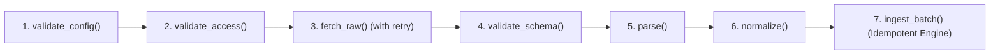
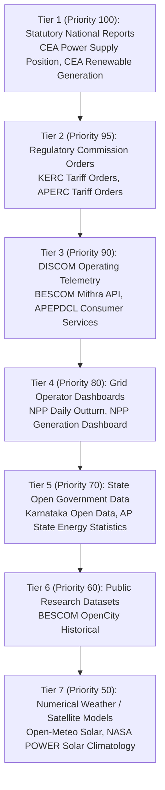

# UrjaSetu EMS — Phase 11 Public Data Connector Architecture

> **Standard**: Production Ingestion Architecture & Provenance Integrity  
> **Status**: Verified Operational Specification  
> **Date**: 2026-10-24  
> **Auditor**: Antigravity Data Platform & Security Engineering  

---

## 1. Architectural Vision & Core Principles

The **UrjaSetu Energy Management System (EMS)** public data ingestion subsystem is engineered to ingest, normalize, validate, and persist official electricity and renewable energy datasets across national, state, utility, and district jurisdictions in India.

### 1.1. Core Invariants
1. **Decoupling Transport from Observation Semantics**: Transport success (HTTP 200, valid SSL handshake, file download) guarantees only that a byte payload was delivered. It does not certify data freshness, physical plausibility, or geographic suitability.
2. **Canonical Normalization Isolation**: Connector retrieval and vendor-specific payload parsing are strictly separated from canonical normalization. Vendor schema quirks (e.g., date formats, abbreviated headers, non-SI units) never leak into the analytical storage layer.
3. **Deterministic Idempotency**: Repeated ingestion of the identical payload yields zero duplicate observations. Every observation slot is uniquely addressed by a canonical composite key.
4. **Transparent Provider Revisions**: When official providers publish revised figures (e.g., CEA revising monthly energy requirements post-audit), the system archives prior versions with an immutable revision log rather than silently overwriting.
5. **Multi-Source Conflict Precedence**: When independent providers report metrics for the identical entity and interval, a formalized precedence hierarchy reconciles the canonical view while recording audit reports for discrepancies exceeding 1.0%.
6. **Anti-Disaggregation Prohibition**: State-level or national aggregate metrics cannot be downscaled to districts through synthetic allocation without direct meter telemetry.

---

## 2. Universal Connector Contract (`BaseEnergyConnector`)

All public electricity and weather connectors inherit from `BaseEnergyConnector` ([base.py](file:///c:/Users/Ram%20Nivas/projects/AVISHKAR-/src/avishkar_ems/trust/connectors/base.py)), enforcing a 7-stage linear pipeline:



### 2.1. Connector Lifecycle Stages

| Stage | Method Signature | Responsibility | Failure Outcome |
| :--- | :--- | :--- | :--- |
| **1. Configuration Validation** | `validate_config() -> tuple[bool, str]` | Asserts presence of required endpoints, base URLs, file paths, and coordinate parameters. | Abort run; return `ImportSummary(status="FAILED")` |
| **2. Access Verification** | `validate_access() -> tuple[bool, str]` | Checks network reachability, TLS trust, or local report file accessibility. | Abort run; status `FAILED` or `AUTHENTICATION_REQUIRED` |
| **3. Raw Retrieval** | `fetch_raw() -> Any` | Fetches payload (JSON dictionary, CSV text, XML, or file bytes) with bounded retries and exponential backoff. | Abort run; status `FAILED` with transport error details |
| **4. Schema Validation** | `validate_schema(raw_data) -> tuple[bool, list[str]]` | Validates top-level JSON keys, table headers, column types, and data types before parsing. | Abort run; status `FAILED` with schema mismatch errors |
| **5. Extraction & Parsing** | `parse(raw_data) -> list[dict[str, Any]]` | Transforms provider payload into intermediate flat records, decoupling vendor quirks. | Abort run if unparseable; partial parsing logs warnings |
| **6. Canonical Normalization** | `normalize(records, run_id) -> list[CanonicalObservation]` | Converts units to SI/standard (MU, MW, W/m², °C), enforces canonical geo-IDs, and tags provenance. | Emits `CanonicalObservation` instances with `QualityStatus` |
| **7. Idempotent Persistence** | `engine.ingest_batch(observations) -> list[IngestionResult]` | Resolves composite keys, performs duplicate elimination, manages official revisions, and generates run summary. | Emits `ImportSummary` with accepted, updated, and rejected counts |

### 2.2. Error Handling & Bounded Retry Matrix

All remote network requests utilize `execute_with_retry()` with parameterized exponential backoff:
- **Maximum Retries**: 3 attempts.
- **Base Delay**: 0.5 seconds.
- **Backoff Factor**: 2.0x ($t_1 = 0.5\text{s}, t_2 = 1.0\text{s}, t_3 = 2.0\text{s}$).
- **Permanent vs Transient Errors**: HTTP 400, 401, 403, 404, and schema validation failures are non-retryable and fail immediately. HTTP 429 (rate limited), 500, 502, 503, and socket timeouts trigger retry loops.

---

## 3. Data Model & Representation

### 3.1. `CanonicalObservation`
Defined in [canonical_observation.py](file:///c:/Users/Ram%20Nivas/projects/AVISHKAR-/src/avishkar_ems/trust/canonical_observation.py), every energy reading is normalized into this immutable structure:

```python
@dataclass(frozen=True)
class CanonicalObservation:
    observation_id: str
    source_id: str
    dataset_id: str
    metric_id: str
    original_metric_name: str
    original_value: float
    original_unit: str
    normalized_value: float
    normalized_unit: str
    geographic_entity_id: str
    geographic_level: str  # NATIONAL, STATE, DISTRICT, UTILITY, HOUSEHOLD
    reporting_period_start: datetime
    reporting_period_end: datetime
    data_classification: DataClassification
    quality_status: QualityStatus
    original_source_record_id: str
    provenance_reference: str
    ingestion_run_id: str
    measurement_kind: MeasurementKind
    observation_timestamp: datetime | None = None
    source_publication_timestamp: datetime | None = None
    retrieval_timestamp: datetime = field(default_factory=lambda: datetime.now(UTC))
    warnings: list[str] = field(default_factory=list)
    rejection_reason: str | None = None
    metadata: dict[str, Any] = field(default_factory=dict)
```

### 3.2. Physical Semantic Distinction (`MeasurementKind`)

To prevent physical unit conflation (e.g. treating instantaneous power MW as energy volume MWh), `MeasurementKind` enforces exact physical dimensions:

| `MeasurementKind` | Physical Dimension | Canonical Unit | Typical Metrics |
| :--- | :--- | :--- | :--- |
| `INSTANTANEOUS_KW` | Power ($P$) | kW | Household peak demand, inverter output |
| `PEAK_MW` | Power ($P$) | MW | Grid peak demand, peak met |
| `INTERVAL_KWH` | Energy ($E = \int P dt$) | kWh | 15-minute / hourly smart meter intervals |
| `PERIOD_TOTAL_MU` | Energy ($E$) | MU ($10^6\text{ kWh} = 1\text{ GWh}$) | Monthly demand, generation outturn |
| `TOTAL_MU` | Energy ($E$) | MU | Annual generation, cumulative utility balance |
| `NAMEPLATE_CAPACITY_MW` | Capacity ($P_{\text{cap}}$) | MW | Installed solar/thermal capacity |
| `RATIO_PERCENT` | Dimensionless | % | T&D loss %, Plant Load Factor (PLF) |
| `IRRADIANCE_WM2` | Radiant Flux Density | $\text{W/m}^2$ | Global Horizontal Irradiance (GHI) |
| `DAILY_INSOLATION` | Radiant Exposure | $\text{kWh/m}^2/\text{day}$ | Daily solar insolation |
| `TEMPERATURE_C` | Thermodynamic Temperature | °C | Ambient 2m dry-bulb temperature |
| `COUNT` | Integer Quantity | Count | Sanctioned service connections |

### 3.3. Standard Ingestion Summaries (`ImportSummary`)

Every connector run produces an immutable `ImportSummary`:
- `run_id`: Unique execution identifier (e.g. `RUN_20261024_152200`).
- `source_id`: Source identifier from authoritative registry.
- `status`: `"COMPLETED"`, `"FAILED"`, or `"PARTIAL"`.
- `retrieved_count`, `accepted_count`, `rejected_count`, `skipped_count`, `updated_count`.
- `duration_ms`: Wall-clock execution time in milliseconds.
- `errors`, `warnings`, `diagnostics`.

---

## 4. Multi-Source Conflict Resolution Engine (`ConflictResolver`)

When multiple independent official bodies publish overlapping metrics for the same region and interval (e.g., CEA monthly state supply vs APSLDC state energy statistics), UrjaSetu EMS reconciles them through `ConflictResolver` ([conflict_resolver.py](file:///c:/Users/Ram%20Nivas/projects/AVISHKAR-/src/avishkar_ems/trust/conflict_resolver.py)).

### 4.1. Precedence Tiers



### 4.2. Conflict Severity Classification

For any two observations $A$ and $B$ where $\text{metric}_A = \text{metric}_B$, $\text{entity}_A = \text{entity}_B$, and $\text{period}_A = \text{period}_B$:

$$\Delta_{\text{rel}} = \frac{|V_A - V_B|}{\max(|V_A|, |V_B|)} \times 100\%$$

1. **`IDENTICAL`** ($\Delta_{\text{rel}} = 0.0\%$): Exact numeric agreement.
2. **`ACCEPTABLE_ROUNDING`** ($0.0\% < \Delta_{\text{rel}} \le 1.0\%$): Reconciled using higher-precedence source; tagged with informational quality note.
3. **`MATERIAL_DISCREPANCY`** ($\Delta_{\text{rel}} > 1.0\%$): Generates a formal `ConflictReport` audit entry. The higher-priority source is retained as canonical; the secondary source is retained with `QualityStatus.REQUIRES_REVIEW`.

---

## 5. Idempotent Ingestion & Official Revision Engine (`IdempotentIngestionEngine`)

Located in [idempotent_ingestion.py](file:///c:/Users/Ram%20Nivas/projects/AVISHKAR-/src/avishkar_ems/trust/idempotent_ingestion.py):

### 5.1. Composite Key Derivation

Every observation is indexed by a 24-character SHA-256 composite key:
$$\text{Key} = \text{SHA256}(\text{source\_id} : \text{metric\_id} : \text{entity\_id} : \text{p\_start} : \text{p\_end} : \text{measurement\_kind})[0:24]$$

This ensures that:
- Identical observation payloads produce identical keys.
- Different metrics or time intervals never collide.
- Two different sources measuring the same slot have distinct composite keys (`source_id` is part of the salt).

### 5.2. Action Outcomes

When ingesting an observation:
- **`INSERTED_NEW`**: Key does not exist. Version 1 record created.
- **`IGNORED_DUPLICATE`**: Key exists, value and unit match within $10^{-6}$. Record skipped without mutation.
- **`REVISED_CORRECTION`**: Key exists, value differs, `allow_official_revisions=True`. Increments version number ($v \leftarrow v + 1$), archives previous observation in `history`, and marks canonical record with `OFFICIAL_PROVIDER_REVISION`.
- **`REJECTED_INVALID`**: Observation failed physical validation rules (e.g. NaN, negative requirement).

---

## 6. Automated Scheduler & Orchestration (`IngestionScheduler`)

Located in [ingestion_scheduler.py](file:///c:/Users/Ram%20Nivas/projects/AVISHKAR-/src/avishkar_ems/trust/ingestion_scheduler.py):
- **Threading Mutex Locks**: Prevents concurrent duplicate execution of the identical source connector. If a job is active in `_active_runs`, subsequent trigger attempts raise `RuntimeError: CONCURRENCY VIOLATION`.
- **Configurable Cadence**: Supports `HOURLY`, `DAILY`, `WEEKLY`, `MONTHLY`, and `MANUAL`.
- **Execution Runbook Support**: Exposes `trigger_sync(source_id, operator_id)` for manual administrative sync and `run_pending_jobs()` for daemon poll loops.
- **Run Auditing**: Retains complete history of `ImportSummary` objects in memory and telemetry logs.

---

## 7. Concrete Connector Implementation Inventory

| Connector Class | Module Path | Data Source | Protocol / Format | Offline Fixture Fallback |
| :--- | :--- | :--- | :--- | :--- |
| `OpenMeteoConnector` | `trust.connectors.openmeteo_connector` | Open-Meteo Solar API | HTTPS REST / JSON | Built-in 24-hour deterministic solar irradiance fixture |
| `NasaPowerConnector` | `trust.connectors.nasa_power_connector` | NASA POWER Climatology | HTTPS REST / JSON | Built-in 12-month annual climatology insolation fixture |
| `ApStateEnergyConnector` | `trust.connectors.ap_connector` | APSLDC / APERC | Statutory JSON Report | `data/energy_reports/ap_state_balance.json` |
| `BescomHistoricalConnector` | `trust.connectors.karnataka_connector` | BESCOM / OpenCity | Public CSV | `data/energy_reports/bescom_historical_consumption.csv` |
| `NppDailyOutturnConnector` | `trust.connectors.npp_connector` | National Power Portal | Statutory JSON Report | `data/energy_reports/npp_daily_outturn.json` |
| `CeaPowerSupplyConnector` | `trust.connectors.cea_connector` | Central Electricity Authority | Statutory JSON Report | `data/energy_reports/cea_national_balance.json` |
| `DiscomCustomerConnector` | `trust.connectors.discom_connector` | BESCOM Mithra / APEPDCL | Restricted API / PDF Bill | `data/sample_bills/` |
