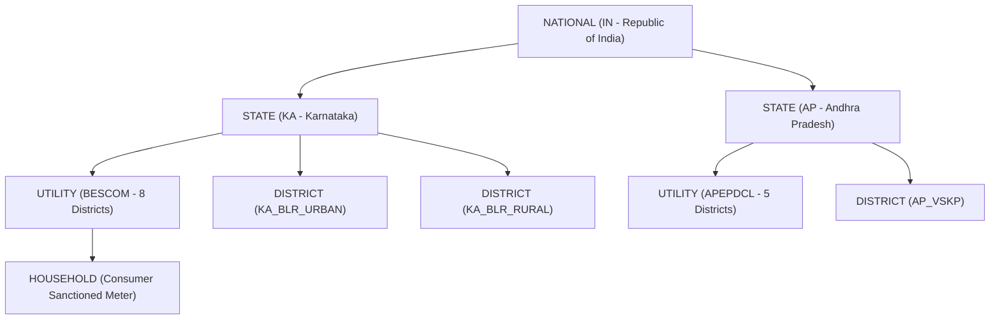

# UrjaSetu EMS — Phase 11 Energy Data Validation & Normalization Rules

> **Standard**: Data Integrity, Metric Semantics & Geographic Quality Protocol  
> **Status**: Verified Operational Specification  
> **Date**: 2026-10-24  
> **Auditor**: Antigravity Data Platform & Security Engineering  

---

## 1. Executive Summary & Quality Mandate

The **UrjaSetu Energy Management System (EMS)** processes public grid telemetry, solar climatology models, and utility billing records. Data integrity is the core product requirement: inaccurate, silently coerced, or falsely disaggregated data undermines analytical trust and violates regulatory engineering standards.

Every observation ingested into UrjaSetu EMS is audited against **13 automated quality rules**, **physical plausibility boundary checks**, and strict **geographic hierarchy constraints**.

---

## 2. Metric Semantics & Dimensional Integrity

Physical dimensions must never be conflated. Power ($P$), energy ($E$), capacity ($P_{\text{cap}}$), and dimensionless ratios are strictly categorized:

$$E = \int_{t_1}^{t_2} P(t) \, dt \quad \Longleftrightarrow \quad E \approx P \times \frac{\Delta t}{60} \quad (\text{for constant } P \text{ over } \Delta t \text{ minutes})$$

### 2.1. Physical Dimensions & Canonical Base Units

| Dimension | Physical Quantity | Canonical Storage Unit | Permitted Source Units | Disallowed Conversions |
| :--- | :--- | :--- | :--- | :--- |
| **`POWER`** | Rate of energy dispatch | $\text{MW}$ / $\text{kW}$ | $\text{W}, \text{kW}, \text{MW}, \text{GW}$ | Cannot convert to Energy without explicit $\Delta t$. |
| **`ENERGY`** | Volume of electricity | $\text{MU}$ ($1\text{ MU} = 1\text{ GWh} = 10^6\text{ kWh}$) | $\text{Wh}, \text{kWh}, \text{MWh}, \text{GWh}, \text{MU}$ | Cannot divide by capacity to yield instantaneous efficiency. |
| **`CAPACITY`** | Nameplate DC/AC rating | $\text{MW}$ | $\text{kWp}, \text{kW}, \text{MW}, \text{MWp}, \text{GW}$ | Cannot sum with generated energy. |
| **`FLUX_DENSITY`**| Surface solar irradiance | $\text{W/m}^2$ | $\text{W/m}^2, \text{kW/m}^2$ | Cannot equate with daily cumulative insolation. |
| **`EXPOSURE`** | Daily radiant insolation | $\text{kWh/m}^2/\text{day}$ | $\text{kWh/m}^2/\text{day}, \text{MJ/m}^2/\text{day}$| Cannot treat as instantaneous power. |
| **`TEMPERATURE`** | Ambient surface temp | $^\circ\text{C}$ | $^\circ\text{C}, \text{K}, ^\circ\text{F}$ | Bound to range $[-20^\circ\text{C}, 60^\circ\text{C}]$. |
| **`PERCENTAGE`** | Dimensionless fraction | $\%$ | $\%, \text{fraction}, \text{pct}$ | Bound to range $[0.0\%, 100.0\%]$. |

---

## 3. Physical Plausibility Boundary Checks

Physical boundary checks detect corrupted records, measurement inversion, or transmission errors before persistence:

| Metric Category | Minimum Plausible Value | Maximum Plausible Value | Violation Action |
| :--- | :--- | :--- | :--- |
| **All-India Grid Peak Demand** | $50,000\text{ MW}$ | $400,000\text{ MW}$ | `REJECTED` (`DQ010_PHYSICAL_RANGE`) |
| **State Peak Demand (KA / AP)** | $1,000\text{ MW}$ | $30,000\text{ MW}$ | `REJECTED` (`DQ010_PHYSICAL_RANGE`) |
| **Solar Irradiance (GHI)** | $0.0\text{ W/m}^2$ | $1,400.0\text{ W/m}^2$ (Solar Constant $\approx 1361\text{ W/m}^2$) | `REJECTED` (`DQ010_PHYSICAL_RANGE`) |
| **Daily Solar Insolation** | $0.0\text{ kWh/m}^2/\text{day}$ | $12.0\text{ kWh/m}^2/\text{day}$ | `REJECTED` (`DQ010_PHYSICAL_RANGE`) |
| **Thermal Plant Load Factor (PLF)** | $0.0\%$ | $100.0\%$ | `REJECTED` (`DQ010_PHYSICAL_RANGE`) |
| **T&D Loss Percentage** | $0.0\%$ | $60.0\%$ | `WARNING` if $> 35\%$; `REJECTED` if $< 0\%$ or $> 80\%$ |
| **Ambient Temperature** | $-20.0^\circ\text{C}$ | $60.0^\circ\text{C}$ | `REJECTED` (`DQ010_PHYSICAL_RANGE`) |
| **Household Monthly Consumption** | $0.0\text{ kWh}$ | $10,000.0\text{ kWh}$ | `WARNING` if $> 2,000\text{ kWh}$ |

---

## 4. The 13 Data Quality Rules (`DataQualityValidator`)

Located in [data_quality.py](file:///c:/Users/Ram%20Nivas/projects/AVISHKAR-/src/avishkar_ems/trust/data_quality.py):

| Rule ID | Rule Name | Severity | Condition & Invariant Description |
| :--- | :--- | :--- | :--- |
| **`DQ001`** | `REQUIRED_FIELDS` | `ERROR` | `observation_id`, `source_id`, and `metric_id` must be non-empty strings. |
| **`DQ002`** | `MALFORMED_VALUE` | `ERROR` | Numeric value cannot be `NaN`, `+Inf`, `-Inf`, or unparseable text. |
| **`DQ003`** | `INVALID_UNIT` | `ERROR` | Unit must exist in `unit_validation.py` registry (`ENERGY_TO_KWH`, `POWER_TO_KW`, etc.). |
| **`DQ004`** | `ILLEGAL_NEGATIVE` | `ERROR` | Forbids negative values for energy requirement, supply, peak demand, generation, and capacity. (Permitted for net power export and temperature). |
| **`DQ005`** | `CHRONOLOGY_ORDER` | `ERROR` | `reporting_period_start <= reporting_period_end`. Period start cannot succeed period end. |
| **`DQ006`** | `FUTURE_DATE` | `WARNING` | Observation timestamp cannot be in the future, unless classification is explicitly `FORECAST` or `SCENARIO_SIMULATION`. |
| **`DQ007`** | `UNKNOWN_GEOGRAPHY`| `ERROR` | `geographic_entity_id` must resolve to an authoritative entity in `AUTHORITATIVE_ENTITIES`. |
| **`DQ008`** | `DUPLICATE_RECORD` | `ERROR` | Duplicate observation ID within the same batch is flagged. |
| **`DQ009`** | `MISSING_PROVENANCE`| `ERROR` | `provenance_reference` must be non-empty and at least 3 characters. |
| **`DQ010`** | `PHYSICAL_RANGE` | `ERROR` | Values outside physical boundary limits (e.g. irradiance $> 1400\text{ W/m}^2$, negative demand) fail hard. |
| **`DQ011`** | `GEOGRAPHIC_DISAGG` | `ERROR` | Enforces `AntiDisaggregationGuard`: national/state metrics cannot be downscaled to district level. |
| **`DQ012`** | `UNIT_SCALE_FACTOR` | `WARNING` | Flags extreme scale jumps ($> 5\times$ variance from historical moving average). |
| **`DQ013`** | `CADENCE_MISMATCH` | `WARNING` | Billed duration must match reported metric cadence (e.g. monthly metric requires $\approx 28\text{--}31$ days interval). |

---

## 5. Geographic Hierarchy & Anti-Disaggregation Invariants

Located in [geo_integrity.py](file:///c:/Users/Ram%20Nivas/projects/AVISHKAR-/src/avishkar_ems/trust/geo_integrity.py):

### 5.1. Anti-Disaggregation Guard (`AntiDisaggregationGuard`)
- **Prohibition**: Any algorithm or service attempting to synthesize a district reading by multiplying state totals by an estimated population or area fraction is blocked with `ValueError: Synthetic disaggregation forbidden`.
- **District Truth**: A district-level record is valid if and only if it originates from direct district-level statutory releases (e.g. Karnataka Open Data district generation tables, district census bulletins).

### 5.2. Territory vs Administrative District Distinction
- **BESCOM Territory**: Covers 8 revenue districts: Bengaluru Urban, Bengaluru Rural, Chikkaballapura, Kolar, Davanagere, Tumakuru, Chitradurga, and Ramanagara.
- **Rule**: Never equate BESCOM consumption with Bengaluru Urban District alone. BESCOM totals include rural, industrial, and agricultural irrigation pump sets across 8 distinct revenue jurisdictions.

---

## 6. Timestamp & Period Normalization

### 6.1. Tri-Timestamp Architecture
Every observation records three independent timestamps:
1. **`reporting_period_start` / `reporting_period_end`**: The physical observation window during which the energy was consumed, generated, or measured.
2. **`source_publication_timestamp`**: The timestamp when the official provider compiled and released the report bulletin.
3. **`retrieval_timestamp`**: The exact UTC timestamp when UrjaSetu EMS fetched the payload from the remote server or local report file.

### 6.2. Strict Anti-Interpolation Invariant
- During ingestion, missing intervals (e.g. an offline meter or gap in hourly solar data) are **never** silently interpolated with synthetic data or linear approximations.
- Missing periods are left as explicit gaps in time series storage. Any downstream estimation or forecasting models must explicitly declare imputation methods and classify outputs as `CALCULATED_STATISTIC` or `SCENARIO_SIMULATION`.
