# UrjaSetu EMS — Phase 12 Architecture: Unified Energy Command Center

> **Standard**: Full-Stack Architecture & Data Provenance Specification  
> **Status**: Production-Ready / Implemented  
> **Author**: UrjaSetu Systems Architecture & Engineering  
> **Audit Date**: 2026-10-24  

---

## 1. Executive Mission & System Purpose

Phase 12 consolidates disparate analytical features, specialized domain engines, and public data connectors into a unified, authoritative **Energy Command Center**. The Command Center operates under strict **Truth-in-Data Invariants**, guaranteeing that:
1. Every displayed figure originates from a verified statutory source or a deterministic, traceable calculation.
2. Capacity (MW) and energy generation (MU) are never conflated.
3. State aggregates are strictly prohibited from being synthetically disaggregated to district levels without physical metering (`AntiDisaggregationGuard`).
4. Every analytical insight exposes complete mathematical lineage, underlying observations, confidence scores, and factual, non-accusatory explanations.
5. All metric cards support deep provenance inspection back to the originating statutory records.
6. Exported audit reports (JSON and CSV) enforce strict spreadsheet formula injection sanitization and prevent unauthorized exposure of private household telemetry.

---

## 2. High-Level System Architecture

```mermaid
graph TD
    subgraph Data Sources & Ingestion Layer
        CEA[CEA Statutory Reports]
        POSOCO[Grid-India / POSOCO]
        APSLDC[APSLDC Operational Data]
        BESCOM[BESCOM Historical & Tariffs]
        NPP[National Power Portal]
        NASA[NASA POWER / Open-Meteo]
    end

    subgraph Domain & Trust Layer
        CR[ConflictResolver<br/>Priority-Based Precedence]
        SR[SourceRegistry<br/>Metadata & Provenance]
        MSR[MetricSemanticsRegistry<br/>Dimensional Compatibility]
        ADG[AntiDisaggregationGuard<br/>Boundary Protection]
        HC[HealthCenter<br/>Ingestion & Freshness Tracking]
    end

    subgraph Analytical Engines
        SIE[SolarIntelligenceEngine<br/>Solar MU, Capacity MW, CUF]
        GME[GenerationMixEngine<br/>Fuel Categories & RE Share]
        TST[TimeSeriesTrendsEngine<br/>Chronological Aggregations]
        EE[ExplainableInsightsEngine<br/>Root Cause & Lineage]
    end

    subgraph Phase 12 Authoritative Service
        CCS[CommandCenterService<br/>src/avishkar_ems/command_center_service.py]
        CCS --> |Section A| KPI[System Overview KPIs]
        CCS --> |Section B| TRENDS[Chronological Trends]
        CCS --> |Section C| GENMIX[Generation & Renewable Mix]
        CCS --> |Section D| GEO[Geographic Exploration]
        CCS --> |Section E| HEALTH[Data Health & Freshness]
        CCS --> |Section F| INSIGHTS[Explainable Insights Engine]
        CCS --> |Section G| PROV[Metric Provenance Inspector]
        CCS --> |Section H| EXP[Audit Report Exporter<br/>Formula Injection Defense]
    end

    subgraph Presentation Layer
        UI[Streamlit Application<br/>app/urjasetu_view.py]
        UI --> |Tab 1| ECC[🎖️ 1. Energy Command Center]
        UI --> |Tabs 2-11| DEEP[Specialized Domain Tabs<br/>National, State, Solar, Tariffs, etc.]
    end

    CEA --> CR
    POSOCO --> CR
    APSLDC --> CR
    BESCOM --> CR
    NPP --> CR
    NASA --> CR

    CR --> SIE
    CR --> GME
    CR --> TST
    CR --> HC

    SIE --> CCS
    GME --> CCS
    TST --> CCS
    EE --> CCS
    MSR --> CCS
    ADG --> CCS
    SR --> CCS
    HC --> CCS

    CCS --> ECC
```



---

## 3. Core Component Design & Contracts

### 3.1. Authoritative Backend Service (`CommandCenterService`)
Located at `src/avishkar_ems/command_center_service.py`, this class acts as the single source of truth for the Command Center frontend and API consumers. Frontend components are prohibited from recalculating business formulas independently.

#### Primary Responsibilities:
1. **Dynamic Filter & Coverage Discovery**:
   - `list_supported_territories()`: Discovers available geographic scopes (`IN`, `KA`, `AP`, `KA_BESCOM`, `IN_KA_BLR_URBAN`) annotated with geographic levels (`NATIONAL`, `STATE`, `DISCOM`, `DISTRICT`).
   - `list_supported_periods()`: Identifies chronological reporting periods (`YYYY-MM`) present in verified datasets.
2. **Section A — System Overview (`get_system_overview`)**:
   - Assembles verified executive KPIs: Peak Demand Met ($\text{MW}$), Energy Requirement ($\text{MU}$), Energy Supplied ($\text{MU}$), Installed Solar Capacity ($\text{MW}$), Solar Generation ($\text{MU}$), Total Renewable Generation ($\text{MU}$), and Renewable Generation Share ($\%$) using gross generation as the authoritative denominator.
   - Attaches data status badges (`VERIFIED_STATUTORY`, `VERIFIED_OPERATIONAL`, `UNAVAILABLE`) and explicit quality warnings.
3. **Section B — Chronological Electricity Trends (`get_electricity_trends`)**:
   - Compiles monthly time series for demand met, energy supplied, and solar generation.
   - Calculates period-over-period delta ($\Delta$) and percentage growth ($\%$).
   - Generates explicit missing-data markers for granular entities lacking direct sub-metering.
4. **Section C — Generation & Renewable Intelligence (`get_generation_and_renewables`)**:
   - Decomposes generation into Solar PV, Other RES (Wind, Biomass, Small Hydro $\le 25\text{ MW}$), and Conventional Generation (Thermal, Nuclear, Large Hydro $> 25\text{ MW}$).
   - Integrates CEA standard note regarding hydro classification.
   - Computes solar Capacity Utilization Factor ($\text{CUF}\%$) based on exact days in each reporting month.
5. **Section D — Geographic Exploration Matrix (`get_geographic_exploration`)**:
   - Outlines boundary relations (parent state, served districts, operating utilities).
   - Clearly splits supported vs. unavailable metrics to prevent unwarranted extrapolations.
6. **Section E — Data Health & Freshness Integration (`get_data_health_summary`)**:
   - Pulls pipeline health, connector run status, error counts, and dataset freshness from `HealthCenter`.
7. **Section F — Explainable Insights Engine (`get_explainable_insights`)**:
   - Produces structured, non-accusatory insights with full mathematical lineage, threshold tests, confidence scores, and limitations.
8. **Section G — Metric Provenance Inspector (`inspect_metric_provenance`)**:
   - Traces displayed metrics back to original reporting agencies, statutory references, retrieval timestamps, units, and cryptographic hashes.
9. **Section H — Audit Report Export (`generate_report_payload` & `export_report_csv`)**:
   - Generates reproducible JSON and CSV audits for any selected territory and period filter.
   - Enforces spreadsheet formula injection sanitization on all text outputs.

---

## 4. User Interface Architecture (`app/urjasetu_view.py`)

The user interface integrates the Command Center as the primary tab (`🎖️ 1. Energy Command Center`), setting the executive standard while preserving deep-dive analytical modules in subsequent tabs.

```
+----------------------------------------------------------------------------------------------------+
| URJASETU EMS - ENERGY COMMAND CENTER                                                                |
+----------------------------------------------------------------------------------------------------+
| Shared Filters: [ Territory: Karnataka (KA) v ]  [ Reporting Period: 2024-05 v ]  [ Reset Filters ]|
+----------------------------------------------------------------------------------------------------+
| SECTION A: SYSTEM OVERVIEW                                                                         |
| [ Peak Demand Met ]   [ Energy Supplied ]   [ Solar Capacity ]   [ Solar Generation ] [ RE Share ]  |
| 16,842 MW [VERIFIED]  8,420 MU [VERIFIED]   7,845 MW [VERIFIED]  1,420 MU [VERIFIED]  38.2% [CEA]   |
+----------------------------------------------------------------------------------------------------+
| SECTION B: ELECTRICITY & SOLAR TRENDS        | SECTION C: GENERATION & RENEWABLE MIX               |
| Plotly Chronological Multi-Axis Chart        | Plotly Donut Chart + CEA Fuel Category Breakdown    |
| (Demand Met, Supplied MU, Solar MU)          | (Solar PV, Other RES, Conventional Baseload)        |
+----------------------------------------------------------------------------------------------------+
| SECTION D: GEOGRAPHIC EXPLORATION            | SECTION E: DATA HEALTH & FRESHNESS                  |
| Hierarchy: State (KA) -> Parent: India (IN)  | Active Pipeline Connectors: 5/5 Operational         |
| Supported vs. Unavailable Metrics Matrix     | Latest Ingestion: 2026-10-24 | 0 Active Ingestion Errors |
+----------------------------------------------------------------------------------------------------+
| SECTION F: EXPLAINABLE INSIGHTS ENGINE                                                             |
| [Insight Card 1: Record Solar Contribution] [Insight Card 2: Peak Demand Deficit Guard]           |
| Supporting Data: 1,420.0 MU / 3,712.5 MU     Supporting Data: Peak Met = 16,842 MW (0.0% Deficit) |
| Confidence: 95.0% | Provenance: CEA-GEN-2024 Confidence: 98.0% | Provenance: CEA-DMD-2024         |
+----------------------------------------------------------------------------------------------------+
| SECTION G: METRIC PROVENANCE INSPECTOR       | SECTION H: AUDIT REPORTS & DATA EXPORTS             |
| Select Metric: [ Solar Generation MU v ]     | Export Formats: [ Download JSON ] [ Download CSV ]  |
| Source: CEA | Doc: Monthly Generation Report | Features: Injection-Safe CSV, Authoritative Lineage |
+----------------------------------------------------------------------------------------------------+
```

---

## 5. Security, Privacy & Integrity Guardrails

### 5.1. Strict Separation of Household Data
Public energy command centers report territorial aggregates (national, state, discom). Household smart meter telemetry (e.g. from `HouseholdModule` and `household_import.py`) is restricted to authenticated account dashboards. The Command Center service neither queries nor exposes household consumer IDs, addresses, or private load profiles.

### 5.2. Spreadsheet Formula Injection Defense
To safeguard business users opening CSV exports in Microsoft Excel, LibreOffice, or Google Sheets, all exported text fields are scrubbed by `sanitize_csv_value()`:
- If a string begins with any command character (`=`, `+`, `-`, `@`, `\t`, `\r`), it is prepended with a single quote (`'`).
- Characters that could alter formula evaluation or cause macro execution are neutralized.

### 5.3. Anti-Disaggregation Enforcement
Downscaling state totals to district levels by population or land-area proxies is prohibited by `AntiDisaggregationGuard`:
- If a user selects a district (e.g., `IN_KA_BLR_URBAN`) for which only sub-transmission or solar insolation data exists, macroeconomic generation mix and state-wide demand curves are labeled `UNAVAILABLE` rather than synthetically estimated.

---

## 6. Verification & Architectural Invariants

| Invariant ID | Name | Architectural Enforcement |
| :--- | :--- | :--- |
| **INV-1201** | **Capacity vs Generation** | Capacity is reported strictly in $\text{MW}$; generation strictly in $\text{MU}$. Shared charts utilize independent dual y-axes. |
| **INV-1202** | **Compatible Denominators** | Renewable generation percentage uses strictly within-boundary gross generation reported over identical timeframes. |
| **INV-1203** | **Deterministic Lineage** | Every insight links to mathematical formulas, baseline observations, and retrieval hashes. |
| **INV-1204** | **No Synthetic Disaggregation** | District views gracefully report missing metrics rather than inventing numbers. |
| **INV-1205** | **Zero Dead Controls** | All UI buttons, filter dropdowns, and export triggers execute functional, tested workflows. |
