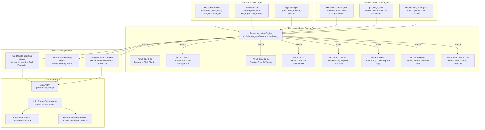

# UrjaSetu EMS — Phase 13 Architecture: Recommendation & Optimization Engine

> **Standard**: Energy Optimization, Recommendation Lifecycle & Anti-Double-Counting Specification  
> **Status**: Production-Ready / Implemented  
> **Author**: UrjaSetu Systems Architecture & Engineering  
> **Audit Date**: 2026-10-24  

---

## 1. Executive Mission & System Principles

Phase 13 establishes an evidence-based recommendation and energy-optimization engine for UrjaSetu EMS. Unlike generic consumer apps that present arbitrary "save 15% on electricity" tips, UrjaSetu enforces strict **Truth-in-Data Invariants**:
1. **Verifiable Baselines**: Every numerical recommendation is anchored to verified utility billing statements, physical meter readings, or explicit user-supplied appliance specifications.
2. **Authoritative Tariffs**: Bill reductions and financial savings are strictly evaluated through `HouseholdTariffEngine` using verified state regulatory commission schedules (KERC LT-2a and APERC LT-1).
3. **Honest Labeling**: Measured billing outturns, reconstructed historical calculations, modeled scenario estimates, and post-action savings are never conflated.
4. **Anti-Double-Counting Guard**: Stacking overlapping recommendations that target the same kilowatt-hours is physically prohibited via sequential marginal evaluation.
5. **Deterministic Prioritization**: Recommendations are ranked by a transparent, multi-factor score (financial impact, evidence confidence, implementation effort, and urgency) rather than opaque black-box heuristics.
6. **Stateful Lifecycle & Ownership**: Full state machine (`PENDING` $\rightarrow$ `VIEWED` $\rightarrow$ `PLANNED` $\rightarrow$ `IN_PROGRESS` $\rightarrow$ `COMPLETED` / `DISMISSED`) backed by immutable transition audit logs and server-side property authorization.

---

## 2. High-Level System Architecture



---

## 3. Core Component Design & Contracts

### 3.1. Recommendation Data Contract (`Recommendation`)
Each recommendation is an immutable record possessing full provenance and mathematical lineage:

```python
@dataclass
class Recommendation:
    recommendation_id: str
    category: RecommendationCategory
    title: str
    description: str
    property_id: str
    user_id: str
    required_inputs: list[str]
    supporting_evidence_refs: list[str]
    baseline_measurement: dict[str, Any]
    proposed_action: str
    calculation_method: str
    assumptions: list[str]
    impact: RecommendationImpact
    confidence_score: float         # 0.0 to 1.0
    effort_level: EffortLevel       # LOW, MEDIUM, HIGH
    urgency: UrgencyLevel           # LOW, MEDIUM, HIGH, CRITICAL
    priority_score: float           # Deterministic 0.0 - 100.0
    relevant_period: str
    source_and_tariff_refs: dict[str, str]
    limitations: list[str]
    status: RecommendationStatus    # PENDING, VIEWED, PLANNED, IN_PROGRESS, COMPLETED, DISMISSED
    created_at: str
    updated_at: str
    completed_at: str | None
    dismissed_reason: str | None
    completion_notes: str | None
    calculation_version: str
    rule_id: str
    is_numeric: bool
    double_count_group: str | None
```

### 3.2. Recommendation Impact Contract (`RecommendationImpact`)
```python
@dataclass(frozen=True)
class RecommendationImpact:
    energy_reduction_kwh_month: float | None
    energy_reduction_kwh_year: float | None
    cost_savings_inr_month: float | None
    cost_savings_inr_year: float | None
    implementation_cost_inr: float | None
    payback_period_years: float | None
    carbon_avoided_kg_year: float | None
```

---

## 4. Recommendation Lifecycle State Machine

The recommendation lifecycle strictly tracks user interaction and prevents unauthorized or contradictory state mutations.

```
       ┌───────────┐
       │  PENDING  │
       └─────┬─────┘
             │ (viewed)
             ▼
       ┌───────────┐
       │  VIEWED   │◄────────────────┐
       └──┬──────┬─┘                 │
          │      │ (plan)            │ (reopen)
  (start) │      ▼                   │
          │  ┌───────────┐           │
          │  │  PLANNED  │           │
          │  └─────┬─────┘           │
          │        │ (start)         │
          ▼        ▼                 │
       ┌───────────────┐             │
       │  IN_PROGRESS  │             │
       └───────┬───────┘             │
               │ (complete)          │
               ▼                     │
       ┌───────────┐                 │
       │ COMPLETED │ (Terminal)      │
       └───────────┘                 │
             ▲                       │
             │ (dismiss from any)    │
       ┌─────┴─────┐                 │
       │ DISMISSED ├─────────────────┘
       └───────────┘
```

### Transition Invariants:
1. **Ownership Enforcement**: Calling `transition_status(user_id, rec_id, target_status)` enforces that `user_id` matches the property owner in `HouseholdManager.get_home(user_id, property_id)`. Cross-user mutation raises `PermissionError`.
2. **Terminal Completion**: Once marked `COMPLETED`, a recommendation cannot be reopened or dismissed.
3. **Reopening Dismissed Actions**: A user may reopen a `DISMISSED` recommendation back to `PENDING` (e.g. upon property lease renewal).
4. **Audit Trail**: Every state transition generates an immutable `LifecycleTransitionRecord` with transition ID, timestamp, actor, and user notes.

---

## 5. Security & Privacy Safeguards

1. **Server-Side Data Isolation**: Recommendation generation, reading, and lifecycle state changes require strict user authentication. Property profiles belonging to `user_default` cannot be accessed or enumerated by an attacker.
2. **No Credential / OTP Exposure**: In accordance with the UrjaSetu privacy directives, utility scraping passwords or consumer OTPs are never stored or exposed in recommendation metadata.
3. **Spreadsheet Formula Sanitization**: All exported recommendations and audit logs neutralize formula command characters (`=`, `+`, `-`, `@`, `\t`, `\r`) via `sanitize_csv_value()`.
