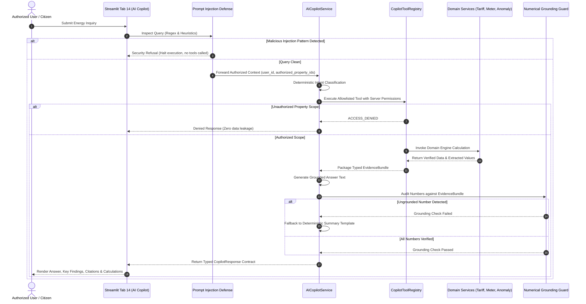

# Phase 16 — AI Energy Copilot & Evidence-Grounded Answers

## 1. Executive Summary & Purpose

The **UrjaSetu AI Energy Copilot** is a domain-specific, evidence-grounded intelligent assistant embedded directly within UrjaSetu EMS. Unlike generic conversational chatbots that hallucinate numbers or cite fabricated sources, the UrjaSetu Copilot is built on strict **Truth-in-Data** principles:

1. **Allowlisted Tool Execution**: The language model cannot execute arbitrary code, shell scripts, or raw database queries. Every data retrieval and calculation is routed through typed, allowlisted application tools.
2. **Server-Side Authorization**: The authenticated identity (`auth_user_id`) and property authorization scope (`authorized_property_ids`) are enforced exclusively by the server at execution time. Prompt instructions or client payloads cannot grant access to foreign household meters or billing data.
3. **Verifiable Evidence Bundles**: Every substantive claim in an answer is backed by an `EvidenceItem` with traceable provenance (DISCOM, CEA, SERC), reporting periods, and calculation methodologies.
4. **Authoritative Calculation Ownership**: All numerical arithmetic (fixed charges, telescopic slab tariffs, solar savings, and anomaly thresholds) is performed by authoritative domain services (`HouseholdTariffEngine`, `AnomalyDetectionEngine`, `RecommendationEngine`), never by language model arithmetic.
5. **Numerical Grounding Guard**: Every factual number output by the model is audited against the assembled `EvidenceBundle`. If any ungrounded value is detected, the Copilot automatically reverts to a safe deterministic summary, completely eliminating numerical hallucinations.

---

## 2. System Architecture & Request Lifecycle

---

## 3. Supported Intent Categories

| Intent Code | Description | Backing Tool | Required Permission |
| :--- | :--- | :--- | :--- |
| `CONSUMPTION_SUMMARY` | Interval usage, daily average, and peak demand (kW). | `get_household_consumption_summary` | `OWNER_ONLY` |
| `BILL_EXPLANATION` | Itemized utility charges, fixed fees, and taxes. | `get_utility_bill_breakdown` | `OWNER_ONLY` |
| `TARIFF_CALCULATION` | Multi-tier slab calculations under statutory orders. | `calculate_bill_under_tariff` | `PUBLIC_OPEN` |
| `ANOMALY_INVESTIGATION`| Rolling MAD statistical outlier detection (>3.0σ). | `inspect_consumption_anomalies` | `OWNER_ONLY` |
| `RECOMMENDATION_EXPLANATION` | Solar, appliance, and load shifting recommendations. | `get_active_recommendations` | `OWNER_ONLY` |
| `PUBLIC_DATA_TRANSPARENCY` | CEA national electricity supply & peak demand met. | `get_public_energy_indicators` | `PUBLIC_OPEN` |
| `GENERAL_ENERGY_QUERY` | High-level energy navigation and guidance. | None (Informational) | `PUBLIC_OPEN` |
| `UNSUPPORTED_OUT_OF_SCOPE` | Adversarial attacks or non-energy requests. | None (Refusal) | `PUBLIC_OPEN` |

---

## 4. UI Integration

Integrated as **Tab 14: 🤖 AI Energy Copilot & Evidence Assistant** in `app/urjasetu_view.py`:
- **Identity Scope Bar**: Binds the active session to the authenticated user and authorized property.
- **Suggested Inquiry Selector**: Quick access to genuine evidence-backed prompts.
- **Status Metrics**: Real-time badges displaying Tool Execution Status, Grounding Guard Outcome, and Latency.
- **Answer Presentation**: Clean markdown card, itemized key findings, expandable verifiable evidence citations table, calculation lineage inspector, and transparent limitations.
- **Architecture Inspector**: Explains tool schemas and invariant security cards.
