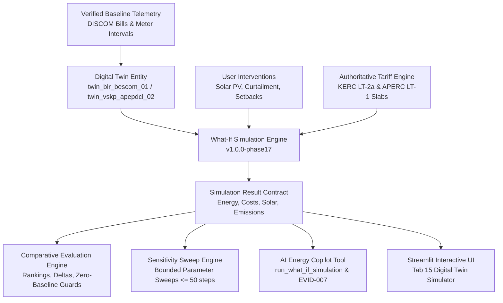

# Phase 17: Energy Digital Twin & What-If Simulation Engine

## 1. Executive Summary

UrjaSetu EMS Phase 17 introduces an authentic, mathematically defensible **Energy Digital Twin and What-If Simulation Engine**. Rather than relying on black-box heuristics or generative AI arithmetic, the engine provides deterministic, reproducible simulations tied to verified physical baselines (meter intervals and DISCOM billing statements) and official regulatory tariff schedules.

The platform distinguishes itself through strict **Truth-in-Data** labeling:
- **`OBSERVED`**: Real-world utility billing statements and interval readings imported from DISCOMs (e.g. BESCOM LT-2a, APEPDCL LT-1).
- **`SIMULATED_SCENARIO`**: Deterministic outcomes modeled by physical equations and statutory tariffs from user-defined parameters.
- **`STATUTORY`**: Official tariff orders issued by State Electricity Regulatory Commissions (KERC, APERC).
- **`ASSUMED`**: Explicitly disclosed engineering parameters (e.g. solar Performance Ratio $PR=0.75$, daily insolation $4.8\text{ kWh/m}^2/\text{day}$, grid emissions factor $0.716\text{ kg CO}_2/\text{kWh}$).

---

## 2. Digital Twin Architecture & Boundaries

A digital twin in UrjaSetu EMS is strictly bound to an identifiable entity, geographic scope, operational baseline, and calibration tier.

### Supported Digital Twin Entities

| Twin ID | Entity / Scope | Utility / Tariff | Baseline Energy | Baseline Bill | Calibration Tier | Validation Tier |
|---|---|---|---|---|---|---|
| `twin_blr_bescom_01` | Indiranagar, Bengaluru (KA) | BESCOM LT-2(a) Domestic | 460.0 kWh (2026-03) | ₹3,540.00 | `CALIBRATED_HISTORICAL` | `VALIDATED_METER_DATA` |
| `twin_vskp_apepdcl_02` | MVP Colony, Visakhapatnam (AP) | APEPDCL LT-1 Domestic | 390.0 kWh (2026-03) | ₹2,890.00 | `CALIBRATED_HISTORICAL` | `VALIDATED_METER_DATA` |
| `twin_ka_macro_grid` | Karnataka Regional Energy Balance | KPTCL / State Grid | 5,850 MU / month | Wholesale Net | `CALIBRATED_HISTORICAL` | `VALIDATED_METER_DATA` |

---

## 3. Core Operating Invariants

1. **Deterministic Reproducibility**: Identical input parameters executed against the same model version (`v1.0.0-phase17`) produce byte-identical outcomes.
2. **Authoritative Financial Calculations**: All bill amounts, slab migrations, fixed charges, and net-metering export credits are calculated by `HouseholdTariffEngine`, never by language model approximations.
3. **Decoupled Capacity vs. Energy**: Installed capacity (kWp/MW) represents equipment rating; generated electricity (kWh/MU) represents time-integrated energy.
4. **Server-Side Authorization**: Private household digital twins enforce tenant ownership (`user_id == owner_user_id`). Forged client-side identifiers are rejected with `PermissionError`.
5. **Bounded Resource Allocation**: Sensitivity sweeps are capped at 50 discrete points to prevent computational denial-of-service.
6. **No AC Power-Flow Pretense**: Regional energy-balance twins explicitly disclose that they model aggregate kilowatt-hour balances and are **not** AC power-flow or transmission stability simulators.
