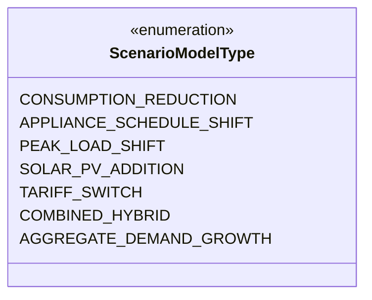

# Phase 17: Simulation Models & Physical Equations

## 1. Supported Simulation Models

UrjaSetu EMS provides six distinct, typed what-if simulation models:

---

## 2. Mathematical Formulations & Derivations

### Model 1: Consumption Reduction (`CONSUMPTION_REDUCTION`)
Models flat energy savings or percentage curtailment across the monthly billing cycle.

$$\Delta E = E_{\text{baseline}} \times \left(\frac{\text{reduction\_pct}}{100}\right) \quad \text{or} \quad \Delta E = \text{reduction\_kwh}$$
$$E_{\text{simulated}} = \max(0, E_{\text{baseline}} - \Delta E)$$
$$P_{\text{peak, sim}} = \max\left(0.5, P_{\text{peak, baseline}} \times \left(1.0 - \frac{\text{reduction\_pct}}{100} \times 0.40\right)\right)$$

*Physical Rationale*: Coincident household peak demand drops by ~40% of the energy reduction percentage due to load diversification.

---

### Model 2: Appliance Rescheduling (`APPLIANCE_SCHEDULE_SHIFT`)
Models operational duration changes for specific high-power appliances (e.g. Inverter Air Conditioners, Water Heaters, EV Chargers).

$$E_{\text{orig, daily}} = \left(\frac{P_{\text{rated, W}}}{1000}\right) \times h_{\text{orig}} \times d_{\text{duty}}$$
$$E_{\text{new, daily}} = \left(\frac{P_{\text{rated, W}}}{1000}\right) \times h_{\text{sim}} \times d_{\text{duty}}$$
$$\Delta E_{\text{month}} = (E_{\text{new, daily}} - E_{\text{orig, daily}}) \times 30$$
$$E_{\text{simulated}} = \max(0, E_{\text{baseline}} + \Delta E_{\text{month}})$$

*Parameters*:
- $P_{\text{rated, W}}$: Appliance nameplate wattage $[10, 25000\text{ W}]$.
- $h$: Operating hours $[0, 24\text{ hours/day}]$.
- $d_{\text{duty}}$: Compressor or duty cycle factor (default $0.70$).

---

### Model 3: Rooftop Solar PV Addition (`SOLAR_PV_ADDITION`)
Simulates rooftop photovoltaic generation, on-site self-consumption, and surplus export under DISCOM net-metering regulations.

$$E_{\text{solar, month}} = C_{\text{kWp}} \times I_{\text{daily}} \times 30 \times PR$$
$$E_{\text{self}} = \min\left(E_{\text{solar, month}} \times \left(\frac{f_{\text{self}}}{100}\right), E_{\text{baseline}}\right)$$
$$E_{\text{import}} = \max(0, E_{\text{baseline}} - E_{\text{self}})$$
$$E_{\text{export}} = \max(0, E_{\text{solar, month}} - E_{\text{self}})$$

*Parameters*:
- $C_{\text{kWp}}$: PV array DC nameplate rating $[0, 100\text{ kWp}]$.
- $I_{\text{daily}}$: Average daily plane-of-array solar insolation ($4.8\text{ kWh/m}^2/\text{day}$ in Bengaluru, $5.0\text{ kWh/m}^2/\text{day}$ in Visakhapatnam).
- $PR$: System Performance Ratio ($0.75$, accounting for inverter losses, DC-AC clipping, dust/soiling, and thermal derating).
- $f_{\text{self}}$: Default on-site self-consumption fraction ($65\%$).

---

### Model 4: Statutory Tariff Switch (`TARIFF_SWITCH`)
Re-evaluates baseline energy under an alternative DISCOM regulatory tariff schedule or adjusted sanctioned load.

$$\text{Bill}_{\text{simulated}} = \text{HouseholdTariffEngine.calculate\_bill}(E_{\text{baseline}}, P_{\text{sanctioned, new}}, \text{Tariff}_{\text{target}})$$

---

### Model 5: Combined Hybrid Intervention (`COMBINED_HYBRID`)
Sequentially models efficiency curtailment followed by rooftop solar self-consumption:

$$E_{\text{gross}} = E_{\text{baseline}} \times \left(1.0 - \frac{\text{reduction\_pct}}{100}\right)$$
$$E_{\text{import}} = \max(0, E_{\text{gross}} - E_{\text{self, solar}})$$

---

### Model 6: Avoided Grid CO2 Emissions
Uses the statutory Central Electricity Authority (CEA) Baseline Database for the Indian Power Sector:

$$\text{CO}_{2, \text{avoided}} = (E_{\text{baseline}} - E_{\text{import}} + E_{\text{export}}) \times 0.716\text{ kg CO}_2/\text{kWh}$$
