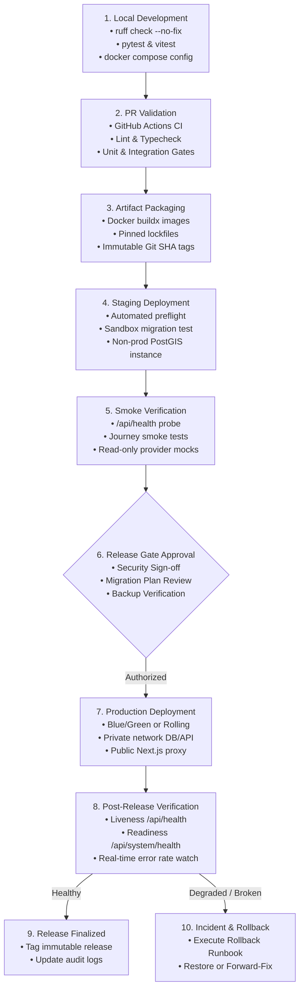

# Phase 24: UrjaSetu EMS Release Engineering & Architecture

## 1. Executive Summary
This document establishes the verified release engineering architecture for the UrjaSetu Energy Management System (EMS). UrjaSetu is a dual-tier system consisting of:
1. **Multi-tier Web & API Platform (`platform/`)**:
   - Next.js 16 SSR Frontend (Node 24, standalone build mode, MapLibre GL v6, strict CSP).
   - Fastify 5 TypeScript REST API (Node 24, first-party cookie sessions, CSRF protection, rate limiting).
   - PostgreSQL 16 + PostGIS 3.4 Spatial Database (Prisma 7 ORM with 11 sequential, additive migrations).
   - Python Optimization Engine (FastAPI microservice running EMHASS linear programming solver via HiGHS).
2. **Standalone Python EMS (`src/avishkar_ems/` & `app/`)**:
   - Streamlit analytics command center and household energy advisor.
   - Python 3.12 probabilistic solar & load band forecasting, tariff intelligence, and operational safety modules.

---

## 2. Release Lifecycle Stages

The path from code commit to verified production release follows a ten-stage pipeline, strictly segregating automated gates from human authorization checkpoints:

### Stage Details & Automation Boundaries

| Stage | Name | Automation | Environment | Enforcement Mechanism |
|---|---|---|---|---|
| **1** | Local Development | Developer / Hook | Local workstation | `ruff check --no-fix`, `pytest tests/avishkar_ems`, `pnpm test` |
| **2** | PR Validation | Fully Automated | GitHub Actions (`ci.yml`) | Pull-request branch protection; minimum 1 approval; zero failing tests |
| **3** | Artifact Packaging | Fully Automated | GitHub Actions (`docker-build.yml`) | Docker buildx with pinned lockfiles (`pnpm-lock.yaml`, `requirements-lock.txt`) |
| **4** | Staging Preflight | Scripted | Staging cluster (`deploy-staging.sh`) | Syntax check, container configuration check, PostGIS extension check |
| **5** | Smoke Verification | Scripted / Automated | Staging cluster | Playwright browser smoke test, synthetic login journey, map worker check |
| **6** | Human Release Gate | **Manual Approval** | Management boundary | SRE & Security lead authorization; verified backup checkpoint required |
| **7** | Production Deployment | Authorized Operator | Production cloud / VM | Explicit operator trigger; container rolling update; private network binding |
| **8** | Post-Release Health | Automated & Human | Production | `/api/health` and `/api/system/health` live polling; error telemetry watch |
| **9** | Release Finalized | Automated | Production | Release tag logged; worklog entry archived |
| **10** | Rollback Response | Human / Automated | Production | Rollback Decision Engine (`RollbackDecisionEngine`) protocol |

---

## 3. Continuous Integration (CI) Quality Gates

The repository defines two authoritative CI workflows in `.github/workflows/`:

### 1. `ci.yml` (Primary CI Suite)
- **Job `python`**:
  - Installs pinned environment from `requirements-lock.txt` (excluding Windows-specific packages `colorama` and `pywin32` on Linux).
  - Lints project code with `ruff check src/avishkar_ems app scripts examples tests/avishkar_ems --no-fix`.
  - Runs all Python tests: `python -m pytest tests/avishkar_ems -q -p no:cacheprovider`.
  - Checks README consistency with `python scripts/update_readme.py --check`.
- **Job `platform`**:
  - Starts real PostgreSQL 16 + PostGIS 3.4 container (`postgis/postgis:16-3.4`).
  - Sets up Node 24 with cached `pnpm` (`platform/pnpm-lock.yaml`).
  - Installs Python 3.12 engine dependencies (`platform/engine/requirements.txt`).
  - Runs `pnpm -C api typecheck`, `pnpm -C api lint`, and `pnpm -C api test` (against real PostGIS database).
  - Compiles API TypeScript build: `pnpm -C api build`.
  - Installs Playwright Chromium browser and executes end-to-end browser journeys against running API, Engine, and Next.js Web processes.
- **Job `engine`**:
  - Python 3.12 engine dependency install and linting.
  - Runs engine unit and integration tests: `python -m pytest tests -q` inside `platform/engine`.
- **Job `web`**:
  - Type-checking (`pnpm -C web typecheck`) and OpenAPI type synchronization check (`git diff --exit-code -- web/src/lib/api-types.ts`).
  - Next.js component unit and accessibility tests (`pnpm -C web test`).
  - Production Next.js standalone build: `pnpm -C web build`.
  - Production smoke test verifying map worker and security headers.

### 2. `docker-build.yml` (Container & Release Safety Gate)
- **Job `validate-docker-compose`**: Validates compose file syntax (`docker compose config`).
- **Job `build-and-test`**: Compiles multi-stage Docker images (`api.Dockerfile`, `engine.Dockerfile`, `web.Dockerfile`).
- **Job `encryption-validation`**:
  - Verifies that no plaintext backup dumps (`*.dump`), encrypted blobs (`*.gpg`), or checksums are tracked in git.
  - Verifies that no secrets files (`secrets_*` except example template) are committed.
  - Verifies that `.env.example` contains only placeholder values.
  - Verifies backup scripts are executable and refuse execution without a passphrase.

---

## 4. Build Artifact Generation & Immutability

1. **Docker Container Images**:
   - `avishkar/api`: Multi-stage build compiling TypeScript, stripping development dependencies, running as non-root user.
   - `avishkar/engine`: Minimal Python 3.12-slim container with HiGHS LP solver pre-compiled.
   - `avishkar/web`: Multi-stage build producing standalone Next.js server (`output: "standalone"`).
2. **Deterministic Version Pinning**:
   - Platform Node dependencies: strictly pinned in `platform/pnpm-lock.yaml` with frozen lockfile install (`pnpm install --frozen-lockfile`).
   - Python dependencies: strictly pinned in `requirements-lock.txt` and `platform/engine/requirements-runtime.txt`.
3. **Artifact Identification**:
   - Every build artifact is tagged with the Git commit SHA (`git rev-parse --short HEAD`) and timestamp. Never deploy mutable `:latest` tags to production.
