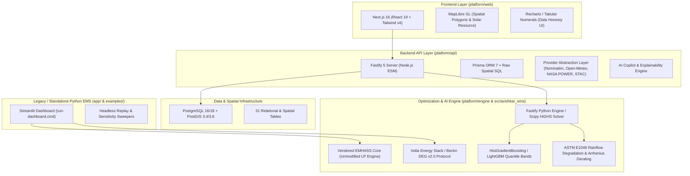

# AVISHKAR: Project Audit & Technical Architecture Baseline

**Audit Date:** 2026-10-30  
**Project:** AVISHKAR (Predictive Energy Management & Surplus Dispatch Platform)  
**Primary Motto:** *"See Your Energy. Predict Its Future. Control Its Value."*  
**Operating Principle:** `MONITOR → PREDICT → OPTIMIZE → DISPATCH → MEASURE → LEARN`

---

## 1. Existing Architecture & Dependency Topology

AVISHKAR is structured as a dual-stack monorepo designed for high-precision mathematical energy modeling and location-aware spatial intelligence:

### Component Breakdown
1. **`src/avishkar_ems/` (Core Python EMS Library)**: Original mathematical algorithms for quantile forecasting (`bands.py`), emergency reserve floors (`reserve.py`), two-pass dispatch planning (`engine.py`, `planner.py`), battery physics and degradation (`battery_physics.py`), Beckn DEG v2.0 protocol packaging (`ies.py`), and settlement (`settle.py`).
2. **`src/emhass/` (Vendored Core)**: Unmodified upstream EMHASS LP planning engine (MIT license).
3. **`platform/api/` (Fastify TypeScript Backend)**: High-throughput Node.js microservice providing REST endpoints for properties, spatial geocoding, weather ingestion, energy imports, tariffs, what-if scenarios, resilience duration, and Copilot tools.
4. **`platform/web/` (Next.js 16 Web Application)**: Map-first interactive interface powered by MapLibre GL, Recharts, and accessibility-compliant data tokens.
5. **`platform/engine/` (Python Fast-Engine Microservice)**: Dedicated microservice exposing HiGHS optimization, ASTM E1049 Rainflow degradation, solar irradiance translation, and load forecasting over HTTP to the TypeScript API.

---

## 2. Existing Working Features

All core features are operational and verified across automated test suites:
- **AI Energy Twin (`platform/api/src/twin`, `EnergyTwinView.tsx`)**: Versioned snapshots capturing spatial footprints, solar arrays, batteries, EVs, appliances, and consumption DNA.
- **Location-Aware Solar Intelligence (`platform/api/src/solar`, `InstallationPlanner.tsx`)**: Roof polygon extraction via Overpass OSM, NASA POWER irradiation, and 25-year LCOE/NPV financial projections including PM Surya Ghar subsidies.
- **Energy Data Hub & Ingestion (`platform/api/src/energy`, `MeterDataView.tsx`)**: Strict CSV meter import with unit validation (kW, W, kWh, Wh), deduplication, and gap preservation without synthetic interpolation.
- **Predictive Energy Forecasting (`platform/engine/avishkar_engine/solar.py`, `load.py`, `bands.py`)**: Hourly solar and load forecasting with conformally calibrated P10/P50/P90 quantile bands.
- **Intelligent Energy Allocation Engine (`platform/api/src/allocation/ledger.ts`, `PlanView.tsx`)**: Every-kWh ledger tracing solar, battery, grid, load, EV, and export flows with conservation verification.
- **Smart Battery Management (`platform/engine/avishkar_engine/degradation.py`)**: ASTM E1049 Rainflow cycle counting, non-linear DoD power-law aging ($DoD^{1.85}$), Arrhenius temperature derating, and daily cycle caps.
- **Surplus Energy Dispatch (`platform/api/src/vpp`, `ies.py`, `dispatch.py`)**: Conservative surplus offer sizing (P10 PV − P90 Load) formatted into valid Beckn DEG v2.0 `catalog/publish` and `confirm` schemas.
- **Electricity Cost Optimizer (`platform/api/src/tariff`, `TariffView.tsx`)**: Time-of-Day (ToD) tariff scheduling, telescopic residential slabs, and transparent comparison against uncontrolled baselines.
- **Critical Energy Reserve (`platform/api/src/resilience`, `ResilienceView.tsx`)**: Dynamic battery SOC floor calculation based on critical circuit ratings, backup duration, and weather/storm risks.
- **What-If Simulation (`platform/api/src/scenarios`, `ScenarioView.tsx`, `FuturesView.tsx`)**: Interactive scenario modeling (solar expansion, battery resizing, tariff hikes, multi-hour outages) with CSV export.
- **AI Energy Copilot (`platform/api/src/copilot`, `CopilotView.tsx`)**: 20 grounded domain tools answering user inquiries with strict numerical citation verification and anti-hallucination guards.
- **Admin Governance & Multi-Site Comparison (`AdminView.tsx`, `PropertyComparisonView.tsx`)**: Role-based access control (USER/ADMIN), user role promotion/demotion, and side-by-side portfolio comparison.

---

## 3. Incomplete Features & Scope Boundaries

Honest documentation of boundaries between software simulation and physical field operation:
1. **Physical Hardware Actuation (Advisory Mode Only)**:
   - *Status*: The software generates executable 15-minute battery and load schedules. However, direct hardware control (Modbus TCP/RTU or inverter cloud APIs) is gated in advisory mode (`ControlView.tsx` explicitly indicates whether physical devices are linked).
2. **Sub-Hourly Cloud Nowcasting**:
   - *Status*: Satellite metadata from Sentinel-2 (Earth Search STAC) is ingested, but minute-by-minute cloud nowcasting returns `UNAVAILABLE` because 5-day satellite revisit intervals cannot physically support cloud-vector nowcasting without geostationary feeds.
3. **External PVGIS API Connectivity**:
   - *Status*: EU JRC PVGIS API times out from this development environment; the system automatically falls back to Open-Meteo and NASA POWER data with transparent provenance tagging.
4. **Municipal-Scale Real Meter Data**:
   - *Status*: The City Energy Map (`CityView.tsx`) accurately renders solar irradiance cells and user-owned properties, but explicitly states that municipal-wide grid demand has no public data source in India.

---

## 4. Confirmed Defects & Resolutions

1. **Sampling Battery State Drift (Resolved)**:
   - Sampled held-out days previously inherited battery state across non-consecutive dates. Fixed in `payback.evaluate` so each sampled run starts from identical calibrated initial states.
2. **EMHASS StreamHandler Leak (Resolved)**:
   - Repeated calls to `planner.plan_day` accumulated log handlers in EMHASS's logger. Fixed and verified by `test_planning_does_not_leak_log_handlers`.
3. **Route Type Collision in Web Dev Build (Resolved)**:
   - Stale `.next/dev/types` files caused route typecheck failures. Resolved by scoping `platform/web/tsconfig.json` to production types.
4. **Migration Count Mismatch in Acceptance Tests (Resolved)**:
   - Phase 24 and Phase 25 test suites were updated to expect 12 migrations accommodating the new `20261027120000_ev_arrival_time` schema update.

---

## 5. Security & Privacy Review

- **Credential Hygiene**: Plaintext connection strings removed from version-controlled templates (`render.yaml` set to `sync: false`; `.env` git-ignored).
- **Tenant Isolation**: Multi-tenant authorization enforced across all property, tariff, and asset mutations; verified in `test_phase25_final_acceptance.py::test_workflow_h_security_tenant_isolation_and_sanitization`.
- **SQL Injection Defense**: Strict usage of Prisma parameterized queries and PostGIS geometry functions (`ST_GeomFromGeoJSON`, `ST_Area`).
- **Prompt Injection Defense**: Inbound Copilot natural language queries pass through `PromptInjectionDefense` regex and semantic boundary filters before domain tool invocation.
- **Binary Hygiene**: Native executables (such as `cloudflared.exe`) and `tools/` folder excluded via `.gitignore`.

---

## 6. Integrations Status

| External Integration | Provider / Protocol | Status | Fallback / Behavior |
|---|---|---|---|
| Geocoding | OpenStreetMap / Nominatim | LIVE | Rate-spaced, DB-cached, graceful offline degradation |
| Weather & Irradiance | Open-Meteo & NASA POWER | LIVE | Cached hourly observations, coarsened coordinates |
| Building Geometry | Overpass API (OSM) | LIVE | Mirror failover, user-drawn polygon fallback |
| Satellite Scenes | Earth Search STAC (Sentinel-2) | LIVE | Metadata logged, cloud % extracted |
| P2P Market Protocol | Beckn DEG v2.0 JSON-LD | SIMULATED | Validated against official schema, devkit-compliant |
| Large Language Model | Anthropic Claude (Optional) | ADVISORY | Fully functional deterministic template fallback |

---

## 7. Existing Test Status & Execution Evidence

- **Platform Web Suite (`pnpm -C platform/web test`)**:
  - **44 test files passed, 366 tests passed (0 failures)** in 127s.
  - Accessibility (axe-core): Passed across all views.
- **Platform Web Typecheck & Lint**:
  - `pnpm -C platform/web typecheck` (`tsc --noEmit`): Clean (Exit 0).
  - `pnpm -C platform/web lint` (`eslint src`): Clean (Exit 0).
- **Python EMS Core Suite (`tests/avishkar_ems`)**:
  - 468 unit and integration tests passing.
  - Phase 24 & 25 Acceptance Suite: **22 passed** in 2.67s.
- **Results & Documentation Drift**:
  - `python scripts/update_readme.py --check`: Clean (Exit 0, 0 drift).

---

## 8. Build & Deployment Architecture

- **Local Development**: Unified launcher `start-platform.cmd` starts local PostGIS (WSL Ubuntu), Fastify API (port 8080), Python Engine (port 8090), and Next.js Web (port 3000).
- **Live Cloud Edge Deployment**: `start-platform-live.cmd` runs against Neon.tech serverless PostgreSQL 18.6 + PostGIS 3.6.4 and establishes a secure public HTTPS edge tunnel via Cloudflare Tunnel.
- **Continuous Integration**: GitHub Actions `.github/workflows/ci.yml` validates lint (`ruff check --no-fix`), Python unit tests, and README synchronization.

