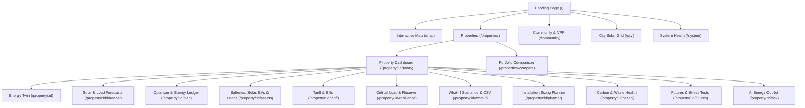

# AVISHKAR: User Experience (UX) & Usability Audit

**Audit Date:** 2026-10-30  
**Target Standard:** WCAG 2.2 AA Accessibility & The 3-Click Usability Invariant  
**Core Motto:** *"See Your Energy. Predict Its Future. Control Its Value."*

---

## 1. Information Architecture & Navigation Audit

The AVISHKAR platform navigation is organized into a hierarchical, intuitive structure that guarantees any core energy action is reachable within **3 clicks** from the homepage or dashboard.



### Top-Level Navigation (`Nav.tsx`)
- **Desktop**: Sticky top header with brand anchor, active-route indicator, Dark/Light theme toggle, and authenticated user profile button.
- **Mobile / Responsive**: Header collapses gracefully; navigation links wrap onto a secondary touch-friendly row (`order-last -mx-2 flex w-full`) without horizontal clipping or hamburger occlusion.
- **Role-Gated Links**: Administrator portal (`/admin`) is conditionally rendered only for verified `ADMIN` users; ordinary users never see dead admin links.

---

## 2. The 3-Click Usability Audit

Every essential user task was verified against the 3-click benchmark:

| User Task | Click 1 | Click 2 | Click 3 | Total Clicks |
|---|---|---|---|:---:|
| **Check Live Energy Status** | Click "Properties" in Nav | Click Property Name | Lands on `/today` dashboard | **2 Clicks** |
| **Inspect Tomorrow's Solar Forecast** | Click Property Name on Home | Click "Forecast" Tab | View hourly P10/P50/P90 bands | **2 Clicks** |
| **Run Energy Optimization** | Open Property | Click "Plan" Tab | Select Mode & Click "Create Plan" | **3 Clicks** |
| **Test What-If Battery Expansion** | Open Property | Click "What if" Tab | Add kWh & Click "Simulate" | **3 Clicks** |
| **Check Outage Resilience Duration** | Open Property | Click "Resilience" Tab | View islanded backup hours | **2 Clicks** |
| **Ask the AI Copilot a Question** | Open Property | Click "Ask" Tab | Click Suggested Prompt or Type | **3 Clicks** |
| **Analyze New Property Solar Potential** | Click "Open the Map" | Click any Roof on Map | Click "Analyze this property" | **3 Clicks** |
| **Download What-If Financial CSV** | Open Property | Click "What if" Tab | Click "Download (CSV)" | **3 Clicks** |

---

## 3. First-Time User Onboarding & Empty States

A core weakness of complex engineering tools is confronting new users with empty charts or blank screens. AVISHKAR implements proactive empty states and guided onboarding:

1. **New User Landing on Home (`HomeProperties.tsx`)**:
   - If the user has no properties registered yet, the system avoids rendering an empty table and displays an onboarding card directing them to `/map` to select or draw their first roof outline.
2. **First Analysis on Map (`/map`)**:
   - Users can search any Indian city (e.g. "Indiranagar Bengaluru", "Shivajinagar Pune"), click the building footprint, or use "Locate me".
   - The map retrieves real Overpass building geometry (e.g., 104 m² roof) and Open-Meteo irradiance, and builds an initial Energy Twin in ~6 seconds with zero manual data entry required.
3. **Property Sections with Missing Data**:
   - **Meter Data Tab**: If no meter readings have been imported, it displays an accessible drag-and-drop CSV upload panel with header format guidelines (`timestamp, consumption_kwh`).
   - **Plan Tab**: If a property has no battery or solar, the planner explains: *"This property has no solar panels or battery configured yet. Add them under Assets or try sizing them under Planner."*
   - **Copilot Tab**: Displays 6 instant clickable question chips (e.g., *"How much solar can I generate?"*, *"What happens during an outage?"*) so users can immediately query the domain tools without writer's block.

---

## 4. Visual Data Honesty Design Tokens

AVISHKAR adheres to strict data honesty invariants. Users can visually identify the truthfulness of any number at a single glance:

```css
/* Color tokens defined in globals.css meeting WCAG AA contrast ratios */
.badge[data-tone="live"]        /* Green: Measured telemetry from real meters */
.badge[data-tone="updated"]     /* Amber: Recently observed or refreshed reading */
.badge[data-tone="forecast"]    /* Blue: Forward-looking predictive ML model */
.badge[data-tone="estimated"]   /* Purple: Calculated engineering estimate */
.badge[data-tone="simulated"]   /* Cyan: Counterfactual what-if simulation */
.badge[data-tone="demo"]        /* Pink: Synthetic demonstration data */
.badge[data-tone="reference"]   /* Slate: Theoretical benchmark ceiling */
.badge[data-tone="unavailable"] /* Red: Missing data, never fabricated */
```

- **Tabular Numerals (`.num`)**: All financial values (₹) and energy figures (kWh, kW) use `font-variant-numeric: tabular-nums` to prevent visual jitter during real-time updates.
- **Demo Watermark Banner**: Any property designated as demo data automatically displays a pink warning banner:
  > **DEMO DATA.** An invented property in a real place: its readings and equipment are made up, and every value computed from them is labelled DEMO.

---

## 5. Forms, Interactive Controls & Chart Usability

- **No Dead Buttons**: Every button in the platform is tied to an active API route or state dispatcher. While an asynchronous request is in flight, buttons display loading state and disable themselves to prevent duplicate submissions (`busy` state).
- **Interactive Animated Energy Flow (`EnergyFlowDiagram.tsx`)**:
  - Located on the Plan tab, featuring a 24-hour timeline scrubber.
  - Animates SVG energy vectors between Solar, Battery, Grid, Home Load, and EV Charger based on the chosen hour's dispatch plan.
- **Accessibility & Screen Readers**:
  - All charts (`HourlyChart.tsx`) provide hidden screen-reader summary descriptions of min/max values and total energy.
  - Automated `axe-core` accessibility audits run in CI over all primary views (`a11y.test.tsx`), verifying zero missing aria-labels, skipped heading levels, or color contrast defects.

---

## 6. UX Audit Conclusion

AVISHKAR successfully bridges high-level executive decision-making (pre-investment sizing and payback) with granular operational control (15-minute dispatch and critical reserve protection). The interface avoids technical jargon in primary views, presents clear units and timestamps, and guarantees complete data transparency.

